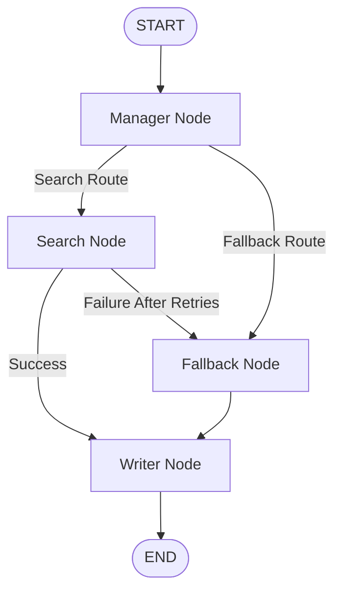

# 🛡️ AI Production Incident Response Agent

**An evolving agentic AI system designed to investigate production failures, analyze system evidence, and help engineers identify and resolve incidents.**

Modern software systems depend on interconnected services, APIs, databases, and external infrastructure. When something fails, identifying the actual cause can be more difficult than detecting the failure itself.

The **AI Production Incident Response Agent** aims to simplify this process by combining agentic workflows, intelligent orchestration, retrieval systems, and fault-tolerant execution.

The project currently has an early working MVP focused on resilient AI orchestration, intelligent routing, retry mechanisms, and fallback retrieval. This foundation will evolve into a more comprehensive production incident investigation and response system.

> **Project Status:** Early MVP — evolving towards an AI-powered production incident investigation and response platform.

---

## 🎯 The Vision

Production incidents require engineers to investigate multiple sources of information before identifying the underlying problem.

This project aims to build an AI agent capable of assisting with that investigation.

The long-term vision is to develop a system that can:

* Analyze application logs and error traces.
* Investigate production failures across different services.
* Retrieve relevant technical documentation and historical incidents.
* Identify potential root causes using collected evidence.
* Generate structured incident investigation reports.
* Recommend practical remediation strategies.
* Verify recovery when connected to appropriate monitoring systems.

The objective is not simply to build another AI chatbot that explains errors.

**The objective is to build an AI engineering assistant that can investigate production incidents through structured, evidence-driven workflows.**

---

## 🏗️ Current MVP Architecture

The current implementation establishes the orchestration and fault-tolerance foundation using LangGraph.

It follows a state-driven workflow with four primary nodes:



### Workflow Components

#### 1. Manager Node

Acts as the decision-making and orchestration layer.

Responsibilities:

* Analyze the incoming query and workflow state.
* Select the appropriate execution route.
* Decide between external retrieval and fallback retrieval.
* Maintain workflow control using structured LLM output.

#### 2. Search Node

Handles primary information retrieval through external search.

Responsibilities:

* Execute external search operations.
* Retry failed requests.
* Handle network and retrieval exceptions.
* Route execution towards fallback when retries are exhausted.

**Current implementation:** Configurable retry handling with simulated network failures for testing failure paths.

#### 3. Fallback Node

Provides an alternative retrieval mechanism when primary search becomes unavailable.

Responsibilities:

* Connect to a local ChromaDB vector database.
* Perform similarity-based retrieval.
* Retrieve relevant stored context.
* Allow the workflow to continue without relying exclusively on external search.

#### 4. Writer Node

Generates the final response using the information collected by previous workflow stages.

Responsibilities:

* Process retrieved context.
* Generate a contextual response.
* Avoid unsupported claims when information is insufficient.
* Communicate when fallback retrieval has been activated.

---

## 🔄 Fault-Tolerant Execution

One of the primary engineering foundations of this project is handling failures without immediately terminating the entire workflow.

### Normal Execution

```text
Incoming Query
      |
      v
Manager Node
      |
      v
Search Node
      |
      v
Writer Node
      |
      v
Final Response
```

### Failure and Recovery Execution

```text
Incoming Query
      |
      v
Manager Node
      |
      v
Search Node
      |
      v
Retry Mechanism
      |
      v
Retries Exhausted
      |
      v
Fallback Retrieval
      |
      v
Writer Node
      |
      v
Final Response
```

The current implementation demonstrates:

* State-aware workflow orchestration.
* Configurable retry handling.
* Exception handling.
* Alternative retrieval routing.
* Graceful degradation.
* Logging across workflow execution.

**Note:** The current implementation demonstrates retry-and-fallback behavior. A complete production-grade circuit breaker with persistent open/half-open/closed states is part of the future engineering direction, not an existing capability.

---

## 🧠 Engineering Concepts

### Agentic Orchestration

Uses LangGraph to coordinate multiple specialized workflow nodes through a shared state.

### State Management

Maintains workflow information including:

* Incoming query.
* Selected execution route.
* Error status.
* Fallback activation status.
* Retrieved information.
* Final generated response.

### Retry and Recovery

Attempts external retrieval again when an operation fails before switching to the fallback mechanism.

### Retrieval-Augmented Generation

Uses ChromaDB and HuggingFace embeddings to retrieve relevant information from a local vector database.

### Structured Decision Making

Uses Pydantic-based structured output to constrain routing decisions.

### Observability

Uses Python logging to record workflow execution, search attempts, failures, fallback activation, and response generation.

---

## 🛠️ Technology Stack

### AI Orchestration


### LLM & AI Framework


### Retrieval & Search


### Embeddings


### Validation & Configuration


### Logging


---

## 🚀 Product Evolution

The current MVP establishes the initial orchestration and recovery foundation.

The next stage is to transform it into an AI-powered production incident investigation system.

### 1. Incident Detection & Input

Introduce mechanisms to receive production incidents through:

* Application error logs.
* Stack traces.
* Monitoring alerts.
* API failure reports.
* Manual incident descriptions.

### 2. Evidence Collection

Build capabilities to collect and organize relevant information from:

* Application logs.
* Service health information.
* Error traces.
* Technical documentation.
* Historical incident records.

### 3. AI-Powered Investigation

Develop specialized investigation workflows capable of:

* Analyzing incident symptoms.
* Correlating evidence from multiple sources.
* Identifying potential failure points.
* Evaluating competing root-cause hypotheses.
* Producing evidence-backed conclusions.

### 4. Root Cause Analysis

Generate structured incident reports containing:

* Incident summary.
* Observed symptoms.
* Supporting evidence.
* Likely root cause.
* Affected components.
* Confidence and uncertainty.
* Recommended next steps.

### 5. Intelligent Remediation

Introduce remediation recommendations based on investigation results.

Future capabilities may include:

* Suggested recovery procedures.
* Deployment rollback recommendations.
* Configuration correction suggestions.
* Human-approved recovery workflows.
* Post-remediation verification.

### 6. Production-Grade Infrastructure

Strengthen the underlying engineering architecture through:

* Persistent workflow checkpoints.
* Redis-backed state management.
* Exponential backoff.
* Multi-provider integrations.
* Advanced observability.
* Evaluation and tracing.
* Asynchronous execution.
* Reliable failure recovery.

*These are planned capabilities and are not represented as implemented features of the current MVP.*

---

## 📂 Project Structure

```text
AI-Production-Incident-Response-Agent/
│
├── .env
├── .gitignore
├── README.md
├── requirements.txt
│
├── Circuit_Breaker.log
│
└── app/
    ├── config.py
    ├── main.py
    └── prompts.py
```

| File               | Responsibility                                                           |
| ------------------ | ------------------------------------------------------------------------ |
| `config.py`        | Application configuration and environment settings                       |
| `main.py`          | LangGraph workflow, state management, routing, retrieval, and execution  |
| `prompts.py`       | LLM instructions for routing, response generation, and fallback behavior |
| `.env`             | Environment variables and API credentials                                |
| `requirements.txt` | Python dependencies                                                      |

---

## ⚙️ Getting Started

### 1. Clone Repository

```bash
git clone https://github.com/Rex-Code-debug/ai-production-incident-response-agent.git

cd AI-Production-Incident-Response-Agent
```

### 2. Create Virtual Environment

```bash
python -m venv venv
```

### 3. Activate Environment

**Windows**

```bash
venv\Scripts\activate
```

**Linux / macOS**

```bash
source venv/bin/activate
```

### 4. Install Dependencies

```bash
pip install -r requirements.txt
```

### 5. Configure Environment Variables

Create a `.env` file:

```env
GROQ_API_KEY=your_api_key_here
```

### 6. Run the Current MVP

```bash
python app/main.py
```

---

## 🔭 Long-Term Objective

The long-term goal is to create an AI system that moves beyond answering technical questions.

It should be capable of investigating real production incidents, understanding the relationships between system failures, gathering supporting evidence, and helping engineers make better recovery decisions.

The engineering direction focuses on:

* Agentic AI systems.
* Production-grade backend engineering.
* Fault-tolerant orchestration.
* Retrieval-Augmented Generation.
* Multi-step reasoning workflows.
* Observability and reliability engineering.
* Human-in-the-loop incident response.

---

## 👨‍💻 Author

Built as part of an Applied AI Engineering journey.

**Focus Areas:**

* AI Engineering
* Backend Systems
* Agentic Architectures
* LangGraph Orchestration
* Fault-Tolerant Systems
* Retrieval-Augmented Generation
* Production Reliability

---

**From resilient AI workflows to intelligent production incident response.**
